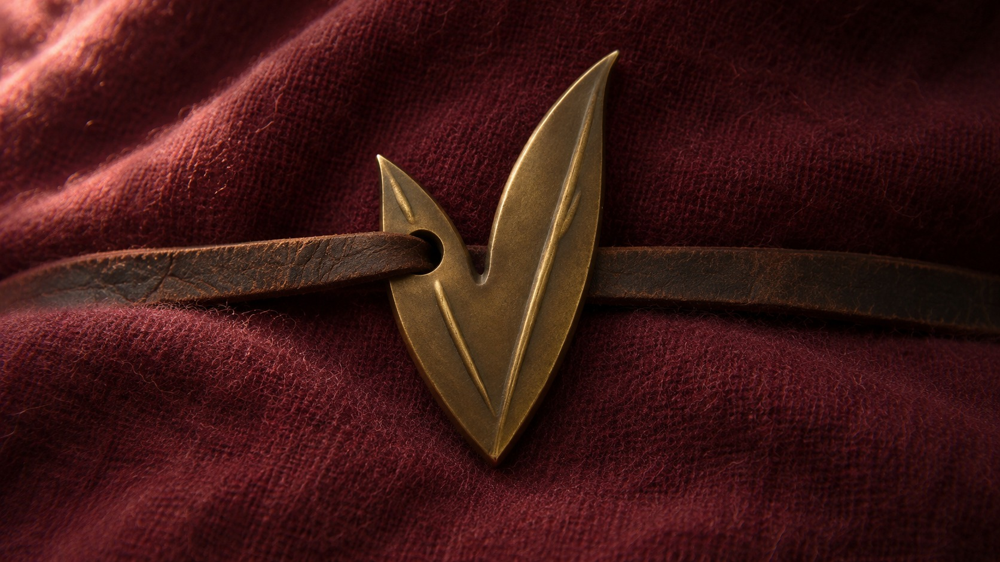
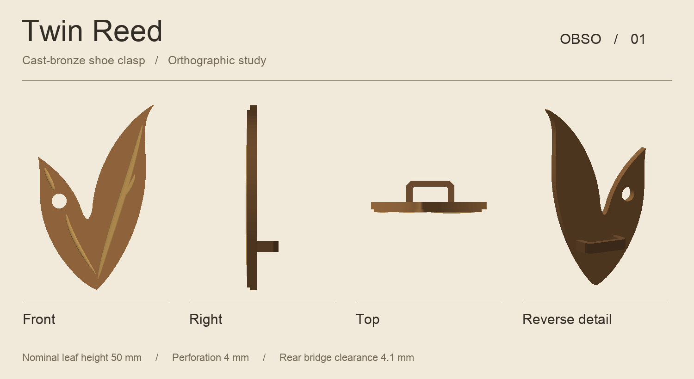
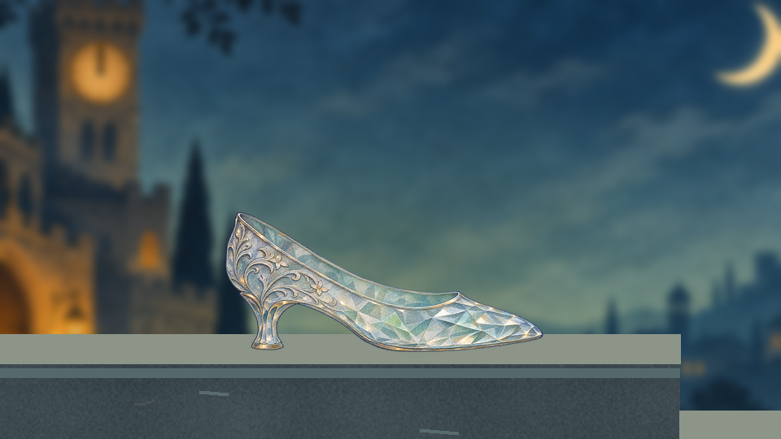
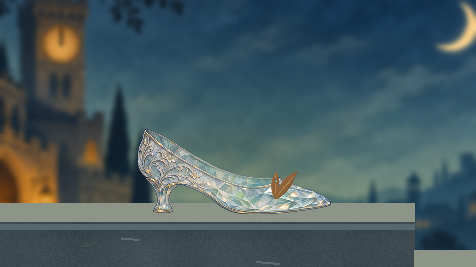

# OBSO · 戏内印记

一套让爱好者在影像里留下创作声明的开放道具设计。标记可以是鞋扣、帽针或斗篷扣。放进一部中世纪故事时，鞋匠应当知道怎样把它缝上去，角色也应当有理由穿着它。观众可以在这里对照形状，了解制作者想表达什么。

**Twin Reed** is a wearable, in-world mark for unofficial, noncommercial fan productions made with AI assistance. This repository publishes the object, its visual grammar and a short animated example. The design is free to copy, adapt and integrate.

[观看《十二点以后》十秒短片](https://github.com/st666xiao/obso-inscene/releases/download/v0.1.0/midnight.mp4) · [下载可编辑三维模型](design/twin-reed.glb?raw=true) · [道具三视图](design/orthographic.png) · [接入制作流程](docs/usage.md)

## 一件道具怎样成为水印

鞋跟落地时，镜头里先读到的是一只鞋。仔细看鞋面，才会发现长短不一的两片苇叶合在同一根部，短叶穿着一个小孔。认识这个轮廓的人可以去找项目说明；第一次接触的观众，可以从片尾或发布页的项目链接了解它。道具面上无需文字、字母、二维码或规定色。

采用本项目约定的作者可以在发布页写下这句话：

> 本片为非官方同人创作，制作过程使用 AI 辅助，作者声明本次发布无商业用途。片中使用 OBSO 双苇扣作为戏内标识。

这里的“非商业”是作者对这次发布用途的自述。“公益”会额外暗示公益目的，作者可按自己的实际情况另行说明。印记本身不能核实声明，也不能授权原作或改变生成平台的规则。

## 首件实物设计语言 · 双苇扣

- **认形。** 两叶共根、长短有别，叶尖之间开口，短叶有一个穿孔。侧看、背看和透视旋转自然会改变投影；辨认以道具自身的长短叶关系为准。
- **安装。** 古铜款的背部有穿带桥。鞋带通过桥下，或以线把桥固定在皮革上。用作帽饰时可以缝在帽带，用作斗篷扣时可以接在系带末端，镜头内保留合理的厚度与遮挡。
- **换时代。** 海边村落可以用贝壳，冬装可以用刻木，科幻作品可以用陶瓷。可以依人物设定改变材料、表面磨损和位置。若改成整顶帽子，把两叶与短叶穿孔做进帽沿折片即可；当前可下载的模型是古铜鞋扣。
- **随环境变化。** 遇水可以变暗、反射水光；在炉旁可以映成暖色；被袖口、裙摆遮住时允许消失。保持同一个挂点和物件的前后连续性。[材质与光照参考](design/conditions.png)

## 例片 · 十二点以后

选取经典动画《灰姑娘》中“午夜钟响、离开舞会、遗落水晶鞋”的情节，按佩罗童话重新调度。镜头从钟面切到侧面奔跑，再跟到鞋离脚、落在石阶上。奔跑的双腿和脱落后鞋的轨迹分别制作，双苇扣固定在鞋面；失鞋后，扣也留在鞋上。成片采用剪纸偶动画、生成的宫殿布景和角色上身、程序合成的钟声、脚步和玻璃落地声。参考作品见 [Disney D23 剧情简介](https://d23.com/a-to-z/cinderella-film/) 和[佩罗童话文本](https://www.colorado.edu/projects/fairy-tales/perrault-cinderella)。

| 相同机位、相同光线 | |
| --- | --- |
| 原鞋面 | 装上双苇扣 |
|  |  |

本片让可复现的合成流程演示佩戴效果。它没有测试某个视频模型自主生成奔跑时的道具一致性。[素材来源、制作方法与重建步骤](docs/production.md)

## 许可与参与

代码采用 MIT。模型、参考图、说明和示范短片中贡献者有权处置的部分采用 CC0 1.0，可免费复制、改造和用于商业工具。下游作品的作者只在声明符合实际用途时使用相应说明。开源范围与全文见 [LICENSE](LICENSE)。

欢迎以 Issue 或 Pull Request 提交其他时代的佩戴版本，最好带上正视图、侧视图和一帧角色佩戴效果；注明哪些轮廓保留、固定在何处、素材由谁制作或授权。模型适配记录请附模型版本、参考图、动作和失败帧，方便下一位作者复现。
